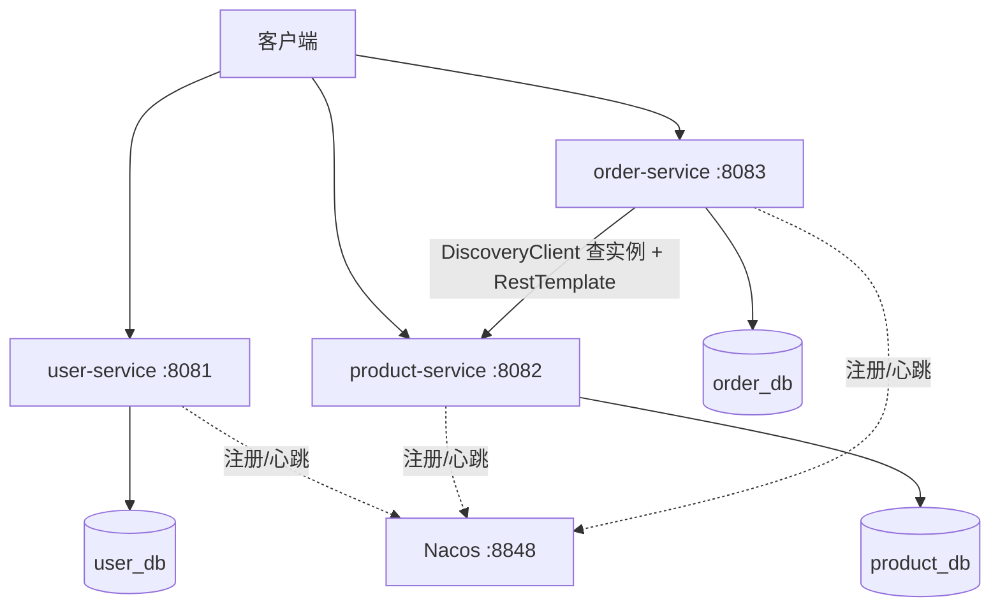

# 社区生鲜团购/配送系统

> 课程：微服务开发与实践
> 姓名：郭浩宇
> 学号：2412190634
> 仓库：microservices-practice-2412190634

## 项目简介

本项目是一个面向城市社区的线上生鲜团购平台，连接供应商、团长与社区居民，覆盖商品浏览、下单、库存扣减、订单生成等核心链路。当前版本按微服务架构组织：用户、商品、订单三个独立服务，各自拥有独立数据库，通过 Nacos 完成服务注册与发现。

## 业务背景

社区居民对生鲜品质和配送时效的要求不断提高，传统电商配送成本高、损耗大；“预售 + 自提/次日达”的社区团购模式可以有效降低履约成本。项目选择该场景，是因为业务闭环完整、角色多，适合从单体逐步演进到微服务。

## 目标用户

- **居民（买家）**：浏览商品、参与团购、下单、凭提货码自提。
- **团长**：管理自提点、分拣商品、核销提货码、佣金结算。
- **供应商**：管理商品、维护库存、处理供货订单。
- **平台管理员**：审核资质、处理售后、查看报表。

> 当前代码实现了“商品 + 订单 + 库存扣减”的最小闭环；支付、核销、认证等为后续演进。

## 系统架构

| 服务 | 端口 | 数据库 | 职责 |
|---|---|---|---|
| user-service | 8081 | user_db | 用户信息 |
| product-service | 8082 | product_db | 商品与库存 |
| order-service | 8083 | order_db | 订单创建与跨服务编排 |
| Nacos | 18080（控制台）/ 8848（API）/ 9848（gRPC） | — | 注册中心 |



## 技术栈

- Java 25
- Spring Boot 4.0.0
- Spring Data JPA + MySQL 8.4.11
- Spring Cloud Alibaba Nacos Discovery 2025.1.0.0
- Spring Boot Actuator
- Docker / Docker Compose
- JUnit 5 + Mockito + H2

## 仓库结构

```text
.
├── monolith/                 # 第 3–5 周的单体基线，保留用于对比
├── services/
│   ├── user-service/         # 8081，user_db
│   ├── product-service/      # 8082，product_db
│   └── order-service/        # 8083，order_db
├── docs/                     # 每周作业记录与设计文档
├── scripts/
│   ├── init-env.sh           # 生成 .env
│   └── smoke-test.sh         # 冒烟验证
├── compose.yaml
└── README.md
```

## 快速开始

### 1. 环境要求

- Java 25
- Docker Desktop（含 Docker Compose）
- Maven Wrapper（仓库已自带，无需全局 Maven）

### 2. 生成环境变量

```bash
bash scripts/init-env.sh
```

脚本会生成 `.env`，包含随机 MySQL 密码和合法的 Nacos Base64 Token；`.env` 已被 `.gitignore` 忽略。

### 3. 启动

```bash
docker compose up -d --build
docker compose ps
```

首次启动需要拉取镜像并构建三个服务，时间取决于网络。

### 4. 健康检查

```bash
curl -s http://localhost:8081/actuator/health
curl -s http://localhost:8082/actuator/health
curl -s http://localhost:8083/actuator/health
bash scripts/smoke-test.sh
```

预期三个接口返回 `{"status":"UP"}`，脚本输出“所有检查通过”。

### 5. Nacos 控制台

http://127.0.0.1:18080
账号 `nacos`，密码见 `.env` 的 `NACOS_PASSWORD`。服务列表应看到三个服务，分组 `PERSONAL_GROUP`，健康实例数各 1。

## 核心业务流程

1. 客户端 `POST /api/orders`，请求体包含 `userId`、`productId`、`quantity`。
2. order-service 通过 `DiscoveryClient.getInstances("product-service")` 获取当前实例。
3. 实例列表为空 → 返回 `503`。
4. 取实例 URI，`PUT /api/products/{id}/deduct?quantity=...` 调用商品服务。
5. 商品不存在 → `404`；库存不足 → `409`；扣减成功 → `200`。
6. order-service 保存订单，返回 `201`。

## API 示例

### 创建商品

```bash
curl -s -X POST http://localhost:8082/api/products \
  -H "Content-Type: application/json" \
  -d '{"name":"有机西红柿","price":8.5,"stock":50}'
```

### 创建订单

把 `productId` 换成上一步返回的 `id`：

```bash
curl -i -X POST http://localhost:8083/api/orders \
  -H "Content-Type: application/json" \
  -d '{"userId":1,"productId":1,"quantity":2}'
```

预期 `201 Created`。

### 错误响应

```bash
# 404：商品不存在
curl -i -X POST http://localhost:8083/api/orders \
  -H "Content-Type: application/json" \
  -d '{"userId":1,"productId":999999,"quantity":1}'

# 409：库存不足
curl -i -X POST http://localhost:8083/api/orders \
  -H "Content-Type: application/json" \
  -d '{"userId":1,"productId":1,"quantity":100}'

# 503：停掉 product-service，等 Nacos 摘除实例后再下单
docker compose stop product-service
sleep 15
curl -i -X POST http://localhost:8083/api/orders \
  -H "Content-Type: application/json" \
  -d '{"userId":1,"productId":1,"quantity":2}'
docker compose start product-service
```

## 测试

每个服务独立测试，使用 H2 内存数据库，测试配置关闭 Nacos 注册：

```bash
cd services/order-service && ./mvnw test
cd ../user-service && ./mvnw test
cd ../product-service && ./mvnw test
```

覆盖点：

- 上下文加载
- 订单库存校验
- `DiscoveryClient` 实例列表为空 → 503

## 设计说明

### 为什么先单体再拆分

单体开发快、事务简单、调试成本低，先把业务边界跑清楚；一上来拆容易变成“分布式单体”。`monolith/` 保留为第 3–5 周的基线，用于对比演进。

### 服务边界与数据归属

- user-service：账号、角色、用户资料。
- product-service：商品、价格、库存。
- order-service：订单创建与交易编排。

订单只保存 `userId`、`productId` 逻辑引用，不跨库建外键；跨服务一致性通过后续的消息/补偿机制演进。

### 服务发现

order-service 每次下单通过 `DiscoveryClient.getInstances("product-service")` 获取实例列表，用实例 URI 调用商品服务的原业务路径；列表为空返回 503。服务地址、数据库连接、Nacos 凭据都通过环境变量注入。

## 当前实现范围

| 能力 | 状态 |
|---|---|
| 三服务拆分、独立数据库 | 已完成 |
| Nacos 注册与发现 | 已完成 |
| 下单扣库存、404/409/503 | 已完成 |
| RestTemplate 连接/读取超时 | 已完成 |
| Docker Compose 一键启动 | 已完成 |
| 冒烟脚本、H2 测试 | 已完成 |
| 客户端负载均衡 | 未实现 |
| 分布式事务/最终一致性 | 未实现 |
| 认证/JWT/网关 | 未实现 |
| 支付、核销、消息通知 | 未实现 |
| 监控/链路追踪 | 未实现 |

> 当前课程演示中数据库使用 root 账号；生产环境应为每个库创建独立账号并遵循最小权限。

## 各周作业文档

- [Week 01：环境与仓库](docs/homework/week-01/index.md)
- [Week 02：项目选题](docs/homework/week-02/index.md)
- [Week 03：Spring Boot 工程](docs/homework/week-03/index.md)
- [Week 04：业务建模与持久化](docs/homework/week-04/index.md)
- [Week 05：Docker 容器化](docs/homework/week-05/index.md)
- [Week 06：微服务拆分](docs/homework/week-06/index.md)
- [Week 07：Nacos 服务发现](docs/homework/week-07/index.md)

设计文档：

- [项目提案](docs/project-proposal.md)
- [数据库设计](docs/database.md)
- [微服务拆分设计](docs/microservices-design.md)

## 历史单体版本（monolith/）

`monolith/` 保留第 3–5 周的单体实现，用于对比演进，不是当前根 `compose.yaml` 的启动目标。

本地运行：

```bash
cd monolith
./mvnw spring-boot:run
```

默认端口 8080，需要本地 MySQL 的 `grocery_db`。

构建镜像：

```bash
docker build -t grocery-monolith:week05 ./monolith
```

## 常见问题

- **Nacos 启动失败**：检查 `.env` 的 `NACOS_AUTH_TOKEN` 是否为合法 Base64；运行 `bash scripts/init-env.sh` 重新生成。
- **服务不在 Nacos**：Nacos 可能还没 ready，等 30 秒或 `docker compose restart order-service`。
- **下单返回 503**：商品服务实例为空或连接失败，检查 `docker compose ps` 和 Nacos 服务列表。
- **端口被占用**：8081–8083、18080、8848、9848 中任一端口冲突都会导致启动失败。
