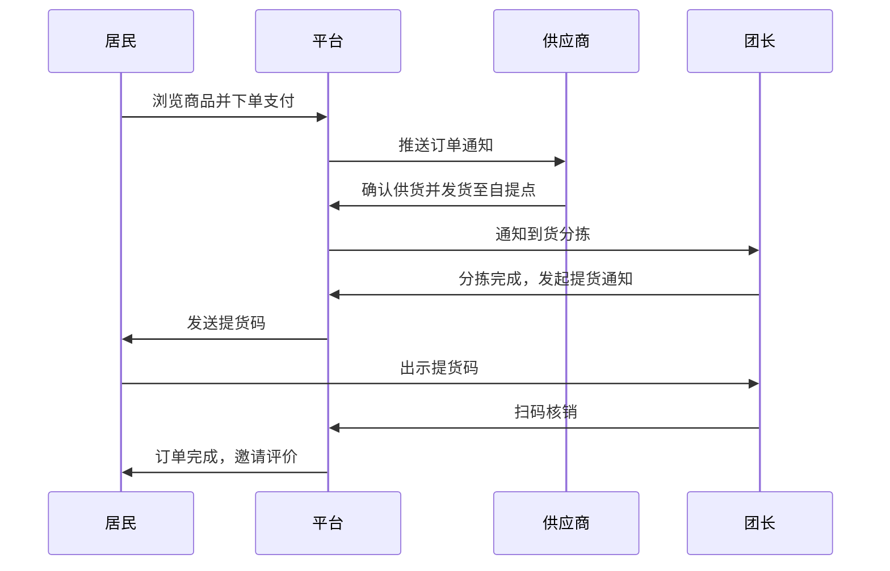

# 微服务实践课程仓库

- **课程**：微服务架构与开发
- **姓名**：郭浩宇
- **学号**：2412190634
- **用途**：本仓库用于存储微服务课程的所有作业、实验代码、文档和项目资料。

# 社区生鲜团购/配送系统

## 项目简介
本项目是一个面向城市社区的线上生鲜团购平台，连接供应商、团长与社区居民，提供从商品浏览、在线下单、支付、分拣到自提核销的全链路服务。

## 业务背景
随着城市生活节奏加快，社区居民对生鲜食材的品质和配送时效提出了更高要求。传统电商配送成本高、损耗大，而社区团购通过“预售+自提/次日达”的模式，有效降低了履约成本。

## 目标用户
- **居民（买家）**：浏览生鲜商品，参与团购，在线支付，凭提货码自提。
- **团长（自提点负责人）**：管理本团订单，分拣商品，核销提货码，申请佣金。
- **供应商**：管理商品上下架，更新库存，处理批量供货订单。
- **平台管理员**：审核资质，处理售后，查看数据报表。

## 用户角色及需求
- **居民（买家）**：需要便捷地浏览商品、参与团购、在线支付、查看订单状态、凭码自提和评价。
- **团长**：需要管理自提点、查看本团订单、分拣商品、核销提货码、查看并提现佣金。
- **供应商**：需要管理商品、维护库存、处理批量供货订单。
- **平台管理员**：需要审核资质、管理分类、处理售后、查看交易数据和佣金结算报表。

## 功能模块划分
| 模块 | 包含功能 |
| :--- | :--- |
| 认证与权限 | 多角色注册、登录、JWT 鉴权、细粒度权限控制 |
| 商品与库存 | 商品管理、分类管理、库存扣减、商品审核 |
| 团购与订单 | 购物车、订单创建、状态流转（待支付/待发货/待自提/已完成） |
| 支付与结算 | 模拟支付、交易流水、佣金计算与结算 |
| 核销与评价 | 提货码生成、团长端扫码核销、买家评价 |
| 消息通知 | 下单通知、提货提醒、状态变更通知 |

## 核心业务流程


## 当前项目范围和暂不实现的内容
当前范围：聚焦于核心交易闭环（用户、商品、订单、支付、核销）的初始版本。
暂不实现：复杂的推荐算法、第三方真实支付接口对接、骑手实时轨迹追踪、高并发秒杀场景。

## 后续可扩展方向
后续将围绕微服务架构进行演进，包括：基于 JWT 的认证服务、按业务边界拆分微服务、基于消息队列（RabbitMQ）的异步通知与事务最终一致性、分布式链路追踪（Micrometer + Zipkin）、Prometheus 监控告警以及基于 Docker Compose 的容器化部署。

## 运行说明

### 环境要求
- Java 25
- Maven Wrapper（无需全局安装 Maven）

### 启动与测试命令（进入 `monolith/` 目录执行）
- 启动测试：`./mvnw test`
- 启动应用：`./mvnw spring-boot:run`

### 接口访问地址
- 问候接口：http://localhost:8080/api/hello
- 健康检查：http://localhost:8080/actuator/health

### 当前未实现的业务能力
暂未实现业务数据库建模、完整 REST API（用户/商品/订单）、Service 层与 Repository 层。

## 本地 MySQL 配置说明

1. 在 WSL 中安装 MySQL 并启动服务。
2. 登录 MySQL 并创建数据库：`CREATE DATABASE grocery_db;`
3. 修改 `monolith/src/main/resources/application.yml` 中的数据库密码，确保与本地一致（默认为 root）。
4. 启动应用时，JPA 将自动建表（`ddl-auto: update`）。

### Week 04 API 验证示例
```bash
# 创建商品
curl -X POST http://localhost:8080/api/products -H "Content-Type: application/json" -d '{"name":"有机西红柿","price":8.5,"stock":50}'

# 创建订单
curl -X POST http://localhost:8080/api/orders -H "Content-Type: application/json" -d '{"productId":1,"quantity":5}'

## Docker 容器化启动指南

1. 复制环境变量模板：`cp .env.example .env`，并修改其中密码。
2. 在仓库根目录执行构建与启动：`docker compose up -d --build`
3. 查看容器状态：`docker compose ps`
4. 停止服务并保留数据：`docker compose down`

### API 测试命令
```bash
# 创建商品
curl -X POST http://localhost:8080/api/products -H "Content-Type: application/json" -d '{"name":"测试生鲜","price":10.0,"stock":100}'
# 查询商品
curl http://localhost:8080/api/products
