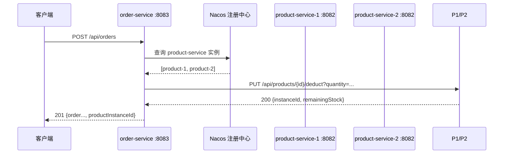

# 服务通信与负载均衡设计

## 1. 跨服务业务流程

**流程**：居民下单时，order-service 调用 product-service 扣减库存；扣减成功后保存订单。

**调用方**：order-service（8083）  
**被调用方**：product-service（两个实例，容器内均为 8082；宿主机映射 8082 和 8092）  
**调用接口**：`PUT /api/products/{id}/deduct?quantity={quantity}`  
**调用方式**：OpenFeign，按服务名 `product-service` 调用，不写容器 IP。



## 2. OpenFeign 实现

### 2.1 客户端

`services/order-service/src/main/java/com/zjgsu/ghy/client/ProductClient.java`

```java
@FeignClient(name = "product-service", configuration = ProductFeignConfig.class)
public interface ProductClient {

    @PutMapping("/api/products/{id}/deduct")
    ProductDeductResponse deduct(@PathVariable("id") Long id,
                                 @RequestParam("quantity") Integer quantity);
}
```

- `name = "product-service"`：服务名，不是 IP。
- Spring Cloud LoadBalancer 从 Nacos 获取实例列表，默认轮询选择。
- 返回值 `ProductDeductResponse` 包含 `instanceId`，用于证明本次命中哪个实例。

### 2.2 调用逻辑

`OrderService.createOrder()`：

1. 校验 `productId` 和 `quantity`。
2. 调用 `productClient.deduct(...)`。
3. 成功：把返回的 `instanceId` 写入订单的 `productInstanceId`（`@Transient`，不落库），保存订单。
4. 失败：按异常类型映射 404/409/503，不保存订单。

### 2.3 错误处理

`ProductFeignErrorDecoder` 把商品服务的 HTTP 状态转换为业务异常：

| 商品服务返回 | Feign 异常 | 订单服务返回 |
|---|---|---|
| 404 Product not found | `ProductNotFoundException` | 404 |
| 409 Insufficient stock | `InsufficientStockException` | 409 |
| 5xx / 连接失败 / 超时 | `ProductServiceUnavailableException` / `FeignException` | 503 |

订单服务配置了 Feign 超时：

```yaml
spring:
  cloud:
    openfeign:
      client:
        config:
          default:
            connectTimeout: 2000
            readTimeout: 3000
```

**写操作超时的边界**：如果扣库存请求已经到达商品服务，但订单服务读取响应超时，商品服务可能已经扣减库存，而订单服务会按 503 处理并回滚本地订单事务。此时结果对调用方是“未知”，需要靠幂等键、订单状态查询或对账补偿解决。当前实现明确按失败处理，不把超时当成功。

## 3. 负载均衡验证

`compose.yaml` 启动两个 product-service 实例：

| Compose 服务 | INSTANCE_ID | 宿主机端口 | 容器内端口 |
|---|---|---|---|
| product-service | product-1 | 8082 | 8082 |
| product-service-2 | product-2 | 8092 | 8082 |

两个实例使用同一个 `spring.application.name=product-service`，注册到 Nacos 同一服务名；`order-service` 通过 OpenFeign + LoadBalancer 轮询调用。

`product-service` 的扣库存响应包含：

```json
{"instanceId":"product-1","remainingStock":48}
```

订单响应包含本次命中的实例：

```json
{"id":10,"userId":1,"productId":5,"quantity":1,"productInstanceId":"product-1"}
```

`scripts/e2e-test.sh` 连续下单 20 次，收集 `productInstanceId` 去重；如果同时出现 `product-1` 和 `product-2`，说明调用方实际访问了两个实例，而不是只看注册列表。

## 4. 测试与运行

### 4.1 启动

```bash
cd ~/projects/microservices-practice-2412190634
docker compose up -d --build
docker compose ps
```

期望：Nacos、3 个 MySQL、user-service、order-service、product-service、product-service-2 全部 Up；MySQL healthy。

### 4.2 一键端到端验证

```bash
bash scripts/e2e-test.sh
```

脚本检查：

1. 3 个服务健康接口。
2. 创建商品。
3. 20 次下单，期望命中 `product-1` 和 `product-2` 两个实例。
4. 商品不存在 → 404。
5. 库存不足 → 409。
6. 停掉两个 product-service → 503，且订单表数量不变。
7. 恢复两个实例 → 再次下单 201。

### 4.3 单元测试

```bash
cd services/order-service
./mvnw test
```

`OrderServiceTest` 覆盖：成功、404、409、503；不依赖真实 Nacos/MySQL。

### 4.4 手工验证

```bash
# 查询两个实例身份
curl -s http://localhost:8082/api/products/instance
curl -s http://localhost:8092/api/products/instance

# 创建商品
curl -s -X POST http://localhost:8082/api/products \
  -H 'Content-Type: application/json' \
  -d '{"name":"演示商品","price":8.5,"stock":50}'

# 下单
curl -i -X POST http://localhost:8083/api/orders \
  -H 'Content-Type: application/json' \
  -d '{"userId":1,"productId":1,"quantity":2}'
```

## 5. 结论

- 调用方只依赖服务名 `product-service`，不依赖实例 IP 和端口。
- OpenFeign 负责声明式调用，LoadBalancer 负责多实例轮询。
- 错误按 404/409/503 分类，依赖不可用时不会把失败当成下单成功。
- 两个实例都实际被调用，负载均衡有可核验的 `productInstanceId` 证据。
